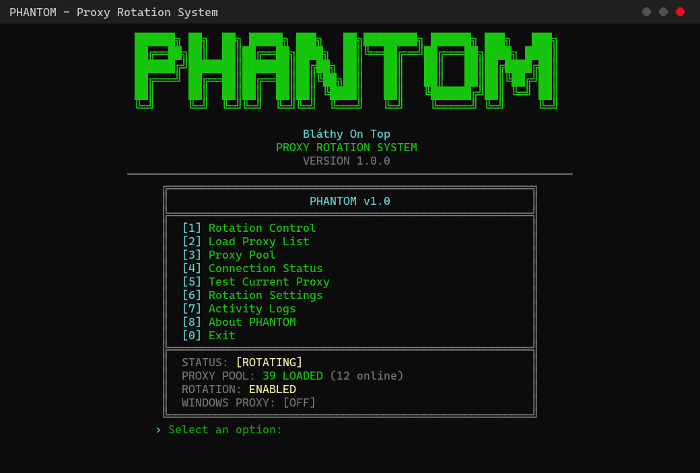
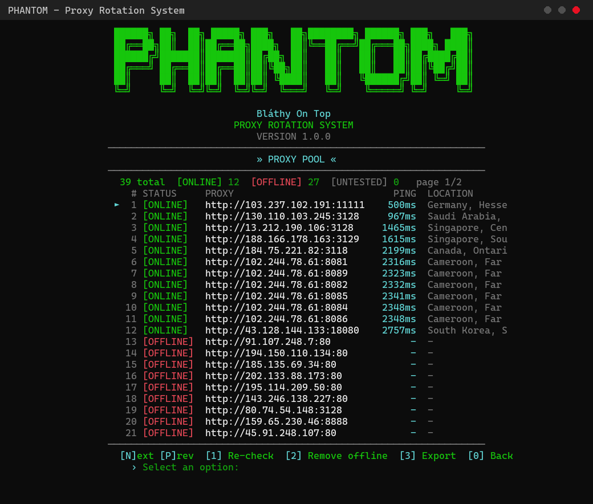
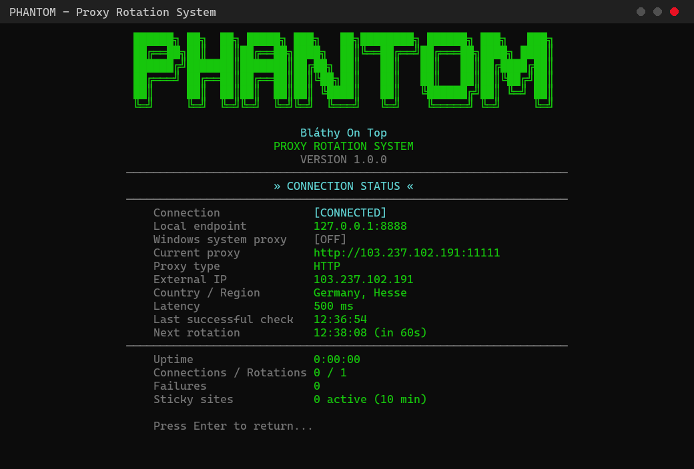
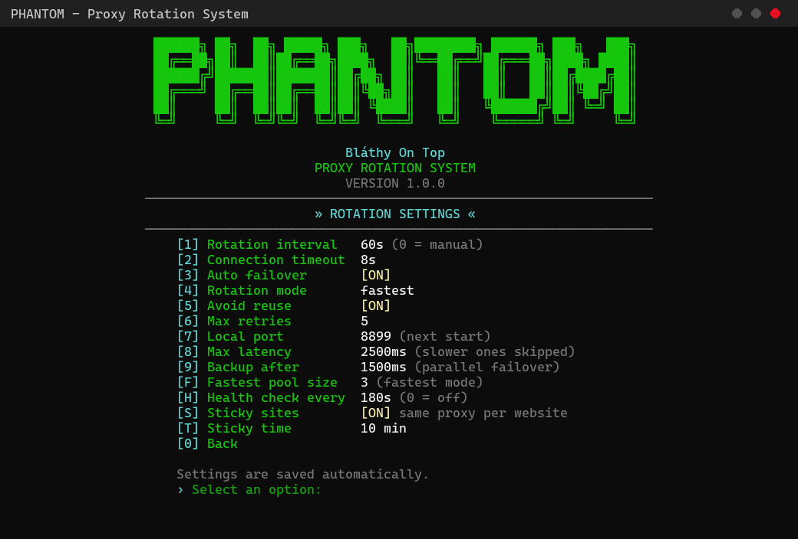

# PHANTOM

<sub>Bláthy On Top</sub>

[](https://github.com/K0RVEXx/PHANTOM/actions/workflows/tests.yml)
[](LICENSE)


> [!IMPORTANT]
> PHANTOM is intended for legitimate purposes only. The author does not endorse any
> illegal activity and accepts no liability for misuse. You are solely responsible for
> how you use it — see [DISCLAIMER.md](app/DISCLAIMER.md).

**PHANTOM** is a terminal-based proxy rotation tool for Windows. It runs a local
proxy on `127.0.0.1` and forwards traffic through proxies from your own lists,
switching between them on a timer, on demand, or automatically when one fails.

```
  ██████╗ ██╗  ██╗ █████╗ ███╗   ██╗████████╗ ██████╗ ███╗   ███╗
  ██╔══██╗██║  ██║██╔══██╗████╗  ██║╚══██╔══╝██╔═══██╗████╗ ████║
  ██████╔╝███████║███████║██╔██╗ ██║   ██║   ██║   ██║██╔████╔██║
  ██╔═══╝ ██╔══██║██╔══██║██║╚██╗██║   ██║   ██║   ██║██║╚██╔╝██║
  ██║     ██║  ██║██║  ██║██║ ╚████║   ██║   ╚██████╔╝██║ ╚═╝ ██║
  ╚═╝     ╚═╝  ╚═╝╚═╝  ╚═╝╚═╝  ╚═══╝   ╚═╝    ╚═════╝ ╚═╝     ╚═╝
```

## Screenshots

| Main menu | Proxy pool |
|---|---|
|  |  |
| **Connection status** | **Rotation settings** |
|  |  |

## Features

- Loads proxy lists from `.txt` files: `IP:PORT`, `IP:PORT:USER:PASS`,
  `USER:PASS@IP:PORT`, with optional `http://`, `https://`, `socks4://`, `socks5://` prefix
- Real availability checks (HTTPS tunnel test) with latency, exit IP, country and region
- Automatic (timed) and manual rotation, random or sequential, with reuse avoidance
- Automatic failover, latency filter and parallel backup attempts for slow proxies
- Fastest mode (rotates among the N fastest proxies) with background health checks
- Sticky sites: each website keeps the same proxy for a set time, so sites like Google
  see a stable IP and show fewer CAPTCHAs
- Connection status, live monitor and timestamped activity logs (credentials are never logged)
- **Optional** Windows system proxy mode — enabled only when you choose it, restored
  automatically when rotation stops, on exit, or on the next start after a crash
- Centered, resize-aware terminal UI that adapts to window size and full screen
- No administrator rights required; settings are saved automatically

## Requirements

- Windows 10 or Windows 11
- Python 3.8 or newer (tick "Add python.exe to PATH" during setup)

Required packages (`app/requirements.txt`) are installed automatically on first start.

## Usage

Start with a double-click on `PHANTOM.bat`, or:

```bash
python app/phantom.py
```

1. Put your proxy lists (`.txt`) into the `proxies` folder
   (see `proxies/example.txt` for the supported formats).
2. **[2] Load Proxy List** — choose a list and run the availability check.
3. **[1] Start Proxy Rotation** — starts the local proxy at `127.0.0.1:8888`.
4. Point an application at `127.0.0.1:8888`, or use option **[4]** in the rotation
   menu to route Windows through PHANTOM.

Quick test from a command prompt:

```bash
curl -x http://127.0.0.1:8888 https://api.ipify.org
```

## Project structure

```
PHANTOM/
├── PHANTOM.bat          start here (double-click)
├── README.md
├── LICENSE
├── SECURITY.md
├── tests/               automated tests (pytest)
├── .github/             CI workflow, issue and PR templates
├── proxies/             your proxy lists (.txt) and exported online proxies
└── app/
    ├── phantom.py       launcher, installs requirements automatically
    ├── requirements.txt
    ├── BRANDING.md · DISCLAIMER.md · CONTRIBUTING.md · CHANGELOG.md
    └── phantom/
        ├── app.py       menus and screens
        ├── engine.py    local proxy server, rotation and failover
        ├── tunnel.py    HTTP / HTTPS / SOCKS4 / SOCKS5 upstream connections
        ├── proxy.py     proxy model, list parsing, availability checks
        ├── winproxy.py  optional Windows system proxy (per user, restorable)
        ├── config.py    auto-saved settings (app/phantom_config.json)
        ├── logger.py    activity log (app/logs/phantom.log)
        └── ui.py        colors, layout, resize-aware input
```

## Running the tests

```bash
python -m pip install pytest
python -m pytest tests
```

The tests run offline and never touch your real settings or logs.
They also run automatically on GitHub for every push and pull request.

## Responsible use

PHANTOM is intended for legitimate purposes only, such as privacy, testing your own
services and learning about networking. The author **does not endorse, support or
encourage any illegal activity** and **accepts no liability** for any misuse, damage or
illegal act committed with this software. On first start, PHANTOM asks you to accept
these terms.

Use only proxies you are authorized to use and follow the laws and the terms of the
services you access. Free public proxies are untrusted: never log in to accounts or
send personal data through them. See [DISCLAIMER.md](app/DISCLAIMER.md).

## Contributing

Contributions are welcome — see [CONTRIBUTING.md](app/CONTRIBUTING.md).
Security issues: please follow [SECURITY.md](SECURITY.md).
Release history is in [CHANGELOG.md](app/CHANGELOG.md).

## License

PHANTOM is open source software, available under the **MIT License**.
The full license text is in the [LICENSE](LICENSE) file.

You may use, copy, modify, merge, publish, distribute, sublicense and sell copies of
the software, provided that the copyright notice and the permission notice are
included in all copies or substantial portions of the software.

The **Bláthy On Top** line shown under the name is a personal reference to the
author's school, the Bláthy Ottó Titusz Informatikai Technikum. PHANTOM is an
independent project — it is **not official school software** and is not developed,
endorsed or supported by the school. See [BRANDING.md](app/BRANDING.md).
